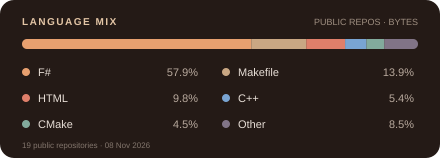

<h1 align="center">Nec0ti</h1>

Electronics · Embedded systems · FPGA

I’m a vocational high-school student in Türkiye focused on electrical and electronic systems. I learn by making things: repairing electronics, building robots and PCBs, and experimenting with FPGA logic. Lately, I’ve been studying computer architecture by building an RV32I CPU.

I also volunteer with TED Translators, translating educational videos from English into Turkish.

### Code by language

  

<a href="https://necoti.dev/cv">Full CV ↗</a>

